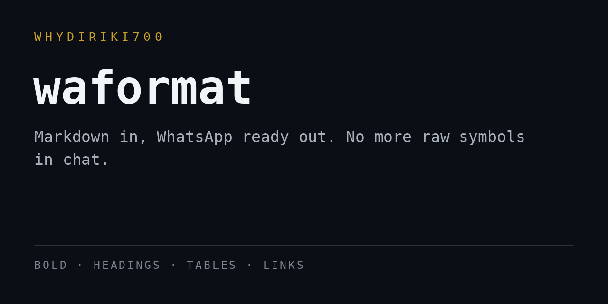

# waformat

Paste AI output into WhatsApp and the `**` and `##` show up raw. waformat
converts Markdown to WhatsApp formatting, and back again.

WhatsApp supports `*bold*`, `_italic_`, `~strikethrough~`, and monospace in
triple backticks. It has no headings, no labelled links, no tables, and no
single backtick code. waformat bridges that gap.

## What it converts

- `**bold**` and `__bold__` become `*bold*`
- `*italic*` becomes `_italic_`, `***both***` becomes `*_both_*`
- `~~strike~~` becomes `~strike~`
- `# Headings` become `*Headings*`
- `[label](https://example.com)` becomes `label (https://example.com)`
- Inline code in single backticks becomes triple backtick monospace
- Markdown tables become readable `cell • cell • cell` lines
- Bullets become `•`, quotes become `»`, rules become a plain line
- Code fences pass through untouched

With `--to-md` the conversion runs the other way, from WhatsApp formatting
to Markdown.

## Usage

```
python -m waformat draft.md -o draft-wa.txt
cat chat-output.md | python -m waformat
python -m waformat --to-md whatsapp.txt -o notes.md
```

## Tests

```
python -m unittest discover -s tests
```

Zero dependencies. Python 3.9+. MIT license.
